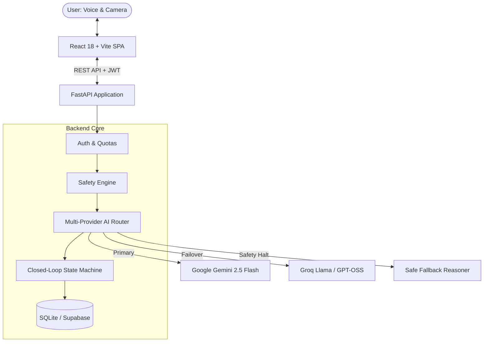

# Sensora AI

<div align="center">


### Real-Time Multimodal Diagnostic Platform for Household & Hardware Devices
*Interactive Video Call, Live Voice Recognition, Vision Inspection, and Safety-First Diagnostics*

[](https://fastapi.tiangolo.com)
[](https://reactjs.org)
[](https://www.typescriptlang.org)
[](https://vitejs.dev)
[](https://deepmind.google/technologies/gemini/)
[](https://groq.com)
[](https://pytest.org)
[](LICENSE)

</div>

---

## 📌 Overview

**Sensora AI** is an intelligent, voice-first, vision-enabled troubleshooting companion designed to diagnose and solve household device issues. Instead of digging through lengthy manuals or searching online forums, users simply show their malfunctioning device via a **live video call** or **uploaded photos** and describe symptoms using **natural voice**. 

Sensora guides users **one step at a time**, inspects the results visually before proceeding, protects users from hazardous internal repairs with built-in safety rules, and generates a structured **Technician Handoff Report** if professional repair is needed.

---

## ✨ Key Features

### 1. 📹 Interactive Live Video Call
- **Real-Time Camera Stream**: Connect with your camera in an interface inspired by modern video calls (FaceTime / Google Meet).
- **Camera Controls**: Switch between front and rear cameras, stop/start video streams, and snap diagnostic frames on demand.

### 2. 📸 Dual Visual Modes: Video or Photos
- **Video Call Mode**: Real-time stream with active HUD controls and frame grabber.
- **Photo Studio Mode**: Drag-and-drop or upload photos/screenshots from mobile or desktop.
- **Photos Saved in History**: Captured and uploaded pictures are preserved and displayed directly within conversation bubbles in the chat log and session details.

### 3. 🎙️ Live Voice Interaction
- **Speech-to-Text**: Real-time transcription via the browser's native Web Speech API with automatic Push-to-Talk fallback.
- **Conversational Spoken Guidance**: Spoken diagnostic steps delivered via browser Speech Synthesis with voice toggle options.

### 4. 🧠 Multi-Provider AI Resilience Engine
- **Primary Reasoner**: Google Gemini 2.5 Flash for multimodal vision and troubleshooting.
- **High-Speed Fallback**: Groq (`openai/gpt-oss-120b`, `whisper-large-v3`) with automated circuit breaking and cooldown.
- **Graceful Offline Mode**: Deterministic safety fallback if third-party providers experience outages.

### 5. 🛡️ Safety Engine & Dual Verification
- **Code-Level Safety Gates**: Deterministic filtering halts guidance on high-voltage risks, gas leaks, smoke, fire, or exposed mains wiring.
- **Smart Negation Parsing**: Distinguishes safety warnings (e.g. *"do not touch exposed wiring"*) from hazardous instructions.
- **Evidence-Based Progress**: Distinguishes between user reports (*"I did this"*) and visual verification (*camera verified*).

### 6. 📋 Technician Handoff & Memory
- Reopen past sessions with complete historical context.
- Export structured, technician-ready diagnostic logs in Markdown or JSON to save repair time and cost.

---

## 🏗️ Architecture



---

## 🚀 Getting Started

### Prerequisites
- **Node.js** 18+ and **npm**
- **Python** 3.10+ (with virtual environment support)
- Free API keys for **Google Gemini** and/or **Groq**

---

### 1. Clone the Repository
```bash
git clone https://github.com/chandana-builds/sensora-ai.git
cd sensora-ai
```

---

### 2. Backend Setup

```bash
# Navigate to backend directory
cd backend

# Create and activate virtual environment
# Windows:
python -m venv .venv
.\.venv\Scripts\activate
# macOS/Linux:
# python3 -m venv .venv
# source .venv/bin/activate

# Install dependencies
pip install -r requirements-dev.txt

# Configure environment
cp .env.example .env
```

Edit `backend/.env` with your preferred AI provider keys:
```env
APP_SECRET=your-secure-random-secret-at-least-32-chars
STORAGE_BACKEND=sqlite
SQLITE_PATH=sensora_dev.db

# Multi-Provider AI Configuration
AI_PROVIDER_ORDER=gemini,groq
GEMINI_API_KEY=your_gemini_api_key_here
GEMINI_MODEL=gemini-2.5-flash
GROQ_API_KEY=your_groq_api_key_here
GROQ_REASONING_MODEL=openai/gpt-oss-120b
```

Run the backend development server:
```bash
uvicorn app.main:app --reload --port 8000
```
*API will be available at `http://127.0.0.1:8000` (docs at `/docs`).*

---

### 3. Frontend Setup

In a new terminal window:
```bash
# Navigate to frontend directory
cd frontend

# Install packages
npm install

# Configure environment
echo "VITE_API_URL=http://127.0.0.1:8000" > .env.local

# Start development server
npm run dev
```
*Frontend will be running at `http://localhost:5173`.*

---

## 🧪 Testing & Verification

Sensora AI is thoroughly tested across both backend services and frontend components.

### Backend Test Suite (119 Tests)
```bash
cd backend
pytest
```
*Tests verify circuit breakers, multi-provider failover, deterministic safety gates, state machines, and API endpoints.*

### Frontend Production Build
```bash
cd frontend
npm run build
```
*Validates full TypeScript type-checking and bundle compilation with zero errors.*

---

## 📂 Project Structure

```
sensora-ai/
├── backend/
│   ├── app/
│   │   ├── ai/               # Multi-provider routing (Gemini, Groq, Meta)
│   │   ├── routes/           # FastAPI routers (sessions, agent, live, auth)
│   │   ├── services/         # Closed-loop engine, safety gate, workflow
│   │   ├── storage/          # SQLite & Supabase document store
│   │   └── main.py           # Application entrypoint
│   └── tests/                # 119 unit & integration tests
├── frontend/
│   ├── src/
│   │   ├── components/       # LiveConsole, StepStatus, HandoffPanel, etc.
│   │   ├── hooks/            # useLiveCamera, usePushToTalk, useSpeechOutput
│   │   ├── pages/            # Live, Dashboard, SessionDetail, History
│   │   └── lib/              # Audio downsampling, frame processing
├── docs/                     # Architecture, API specifications, and audits
└── render.yaml               # One-click deployment specification
```

---

## 🔒 Safety Policy & Responsible AI

Sensora AI adheres to strict hardware safety constraints:
- **No Internal Repairs**: Any detected suggestion to unscrew casings, touch internal capacitors, or modify electrical mains triggers an automatic safety stop.
- **Physical Safety Disclaimer**: Sensora explicitly notes that camera images cannot guarantee physical safety.
- **Privacy First**: Visual frames and camera streams are only stored if explicit user consent is granted. Users can erase all stored evidence at any time.

---

## 📄 License

This project is licensed under the [MIT License](LICENSE).
