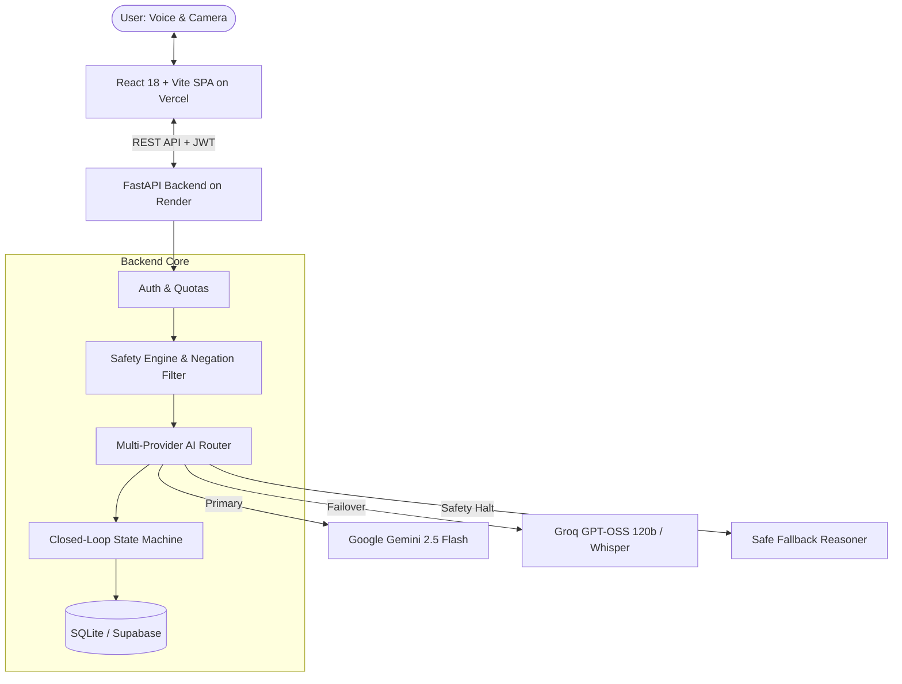

# Sensora AI

<div align="center">


### Real-Time Multimodal Diagnostic Platform for Household & Hardware Devices
*Interactive Video Call, Live Voice Recognition, Vision Inspection, and Safety-First Diagnostics*

[](https://sensora-eight.vercel.app)
[](https://sensora-ai.onrender.com)
[](https://vkkwwrkaovkaeqkdojbl.supabase.co)
[](https://fastapi.tiangolo.com)
[](https://reactjs.org)
[](https://www.typescriptlang.org)
[](https://deepmind.google/technologies/gemini/)
[](https://groq.com)
[](https://pytest.org)
[](LICENSE)

</div>

---

## 🌐 Live Deployments

| Component | Platform | Live URL |
| :--- | :--- | :--- |
| **Frontend Web App** | **Vercel** | [https://sensora-eight.vercel.app](https://sensora-eight.vercel.app) |
| **Backend REST API** | **Render** | [https://sensora-ai.onrender.com](https://sensora-ai.onrender.com) |
| **API Health Check** | **Render** | [https://sensora-ai.onrender.com/api/health](https://sensora-ai.onrender.com/api/health) |
| **Database & Auth** | **Supabase** | `https://vkkwwrkaovkaeqkdojbl.supabase.co` |

---

## 📌 Overview

**Sensora AI** is an intelligent, voice-first, vision-enabled troubleshooting companion designed to diagnose and solve household device issues. Instead of digging through lengthy manuals or searching online forums, users simply show their malfunctioning device via a **live video call** or **uploaded photos** and describe symptoms using **natural voice**. 

Sensora guides users **one step at a time**, inspects the results visually before proceeding, protects users from hazardous internal repairs with built-in safety rules, and generates a structured **Technician Handoff Report** if professional repair is needed.

---

## 🎬 Live Demo & Interactive Walkthrough

Experience Sensora live at [https://sensora-eight.vercel.app](https://sensora-eight.vercel.app) without needing to configure API keys:

### 1. Launch a Troubleshooting Session
1. Navigate to [sensora-eight.vercel.app](https://sensora-eight.vercel.app).
2. Click **"Try Guest Demo"** or sign in with your account.
3. Enter your device (e.g., *boAt Headset*, *Asus RT-AX58U Router*, *LG Washing Machine*) and describe the problem (e.g., *"No sound from wired headset"* or *"Internet light is blinking orange"*).
4. Select your experience level (**Beginner** or **Experienced**) to tailor diagnostic instructions.

### 2. Live Video Call Experience
- Upon entering the workspace, the **LIVE VIDEO CALL** window initializes with your active camera stream.
- Click **"Snap Frame"** anytime to capture what your camera sees for multimodal visual reasoning.
- Switch between multiple cameras (e.g. mobile front/back camera) directly from the floating HUD overlay.

### 3. Capture & Upload Pictures (Photo Studio)
- Switch to the **"Capture & Upload Pictures"** tab to drag-and-drop or select photo files from your smartphone or PC.
- Every captured or uploaded picture is **preserved directly in your conversation history bubbles**, allowing you and repair technicians to review visual evidence alongside each step.

### 4. Hands-Free Voice Dialogue
- Click the **"Speak"** button (or press the microphone toggle).
- The button pulses red with **"Listening…"** and transcribes your voice in real-time via the browser's native Web Speech API.
- The AI speaks diagnostic instructions aloud through browser speech synthesis so you can keep your hands on your device.

### 5. Closed-Loop Dual Verification
- Every diagnostic step requires confirmation before advancing.
- The system distinguishes between **User Confirmed** (*"I did this step"*) and **Camera Verified** (*visual evidence confirms LED state or connection*).

### 6. Technician Handoff Export
- When a hardware issue cannot be solved safely at home, click **"Complete Session"**.
- Export a structured, technician-ready handoff summary in Markdown or JSON detailing:
  - Exact symptoms and initial conditions
  - All attempted troubleshooting steps with visual verification outcomes
  - Recorded hardware observations
  - Remaining unresolved issues for the service technician

---

## ✨ Core Capabilities

### 📹 Live Video Call & Multimodal Vision
- High-resolution camera streaming (`<video autoPlay playsInline muted />`).
- On-demand frame grabber with JPEG downscaling and compression.
- Preserved photo gallery inside chat history.

### 🎙️ Low-Latency Speech System
- Real-time Web Speech API transcription with automatic Push-to-Talk audio recorder fallback.
- Spoken responses via HTML5 SpeechSynthesis.

### 🧠 Multi-Provider AI Fallback Engine
- **Primary Reasoner**: Google Gemini 2.5 Flash for fast multimodal vision and step-by-step troubleshooting.
- **Failover Reasoner**: Groq (`openai/gpt-oss-120b`, `whisper-large-v3`) with automated circuit breaking and cooldown.
- **Graceful Offline Mode**: Safe deterministic fallback if third-party providers experience outages.

### 🛡️ Safety Engine & Hazard Detection
- Code-level deterministic safety screening halts guidance immediately if smoke, fire, sparks, gas leaks, or exposed mains wiring are reported.
- **Smart Negation Parsing**: Distinguishes safety warnings (e.g. *"do not touch exposed wiring"*) from hazardous instructions, eliminating false-positive safety halts on consumer electronics.

---

## 🏗️ System Architecture



---

## 🚀 Local Development

### Prerequisites
- **Node.js** 18+ and **npm**
- **Python** 3.10+
- Free API keys for **Google Gemini** and/or **Groq**

---

### 1. Clone the Repository
```bash
git clone https://github.com/chandana-builds/sensora-ai.git
cd sensora-ai
```

---

### 2. Backend Setup

```bash
cd backend

# Create and activate virtual environment
# Windows:
python -m venv .venv
.\.venv\Scripts\activate
# macOS/Linux:
# python3 -m venv .venv
# source .venv/bin/activate

# Install dependencies
pip install -r requirements-dev.txt

# Configure environment
cp .env.example .env
```

Edit `backend/.env`:
```env
APP_SECRET=sensora-super-secret-key-32-chars-long-minimum-jwt-secret-m4
STORAGE_BACKEND=sqlite
SQLITE_PATH=sensora_dev.db
ALLOW_ANONYMOUS_DEMO=true

AI_MODE=auto
AI_PROVIDER_ORDER=gemini,groq
GEMINI_API_KEY=your_gemini_api_key_here
GEMINI_MODEL=gemini-2.5-flash
GROQ_API_KEY=your_groq_api_key_here
GROQ_REASONING_MODEL=openai/gpt-oss-120b

ALLOWED_ORIGINS=https://sensora-eight.vercel.app,http://localhost:5173
```

Start the backend server:
```bash
uvicorn app.main:app --reload --port 8000
```
*API docs available at `http://127.0.0.1:8000/docs`.*

---

### 3. Frontend Setup

In a separate terminal:
```bash
cd frontend

# Install dependencies
npm install

# Start development server
npm run dev
```
*Frontend will be running at `http://localhost:5173`.*

---

## 🧪 Testing & Verification

### Backend Test Suite (119 Tests)
```bash
cd backend
pytest
```
*Comprehensive test coverage verifying:*
- Multi-provider fallback (Gemini → Groq → Safe Deterministic Fallback)
- Circuit breaker trip and cooldown logic
- Hardware safety policy and negation-aware regex filters
- Verification matrix (visual verification vs. user confirmation)
- Full API authentication and session endpoints

### Frontend Production Build
```bash
cd frontend
npm run build
```
*Validates TypeScript strict compilation and Vite production bundle generation with 0 errors.*

---

## 📂 Project Structure

```
sensora-ai/
├── backend/
│   ├── app/
│   │   ├── ai/               # Multi-provider routing (Gemini 2.5, Groq, Meta)
│   │   ├── routes/           # FastAPI routers (sessions, agent, live, auth)
│   │   ├── services/         # Closed-loop engine, safety gate, workflow
│   │   ├── storage/          # SQLite & Supabase document store
│   │   └── main.py           # Application entrypoint
│   └── tests/                # 119 unit & integration tests
├── frontend/
│   ├── src/
│   │   ├── components/       # LiveConsole (Video Call + Photos), StepStatus, HandoffPanel
│   │   ├── hooks/            # useLiveCamera, usePushToTalk, useSpeechOutput
│   │   ├── pages/            # Live, Dashboard, SessionDetailPage, History
│   │   └── lib/              # Audio processing, frame compression, auth
│   └── vercel.json           # Vercel deployment & CSP headers
├── docs/                     # Architecture, API specifications, and audits
└── render.yaml               # Render Cloud deployment blueprint
```

---

## 🔒 Safety Policy & Responsible AI

Sensora AI is engineered for safe home device troubleshooting:
- **No Internal Repairs**: Any detected suggestion to unscrew casings, touch internal capacitors, or modify electrical wiring triggers an automatic safety stop.
- **Physical Safety Disclaimer**: Sensora explicitly notes that camera images cannot guarantee physical safety.
- **Privacy First**: Visual frames and camera streams are only stored if explicit user consent is granted. Users can delete all stored evidence at any time.

---

## 📄 License

This project is licensed under the [MIT License](LICENSE).
